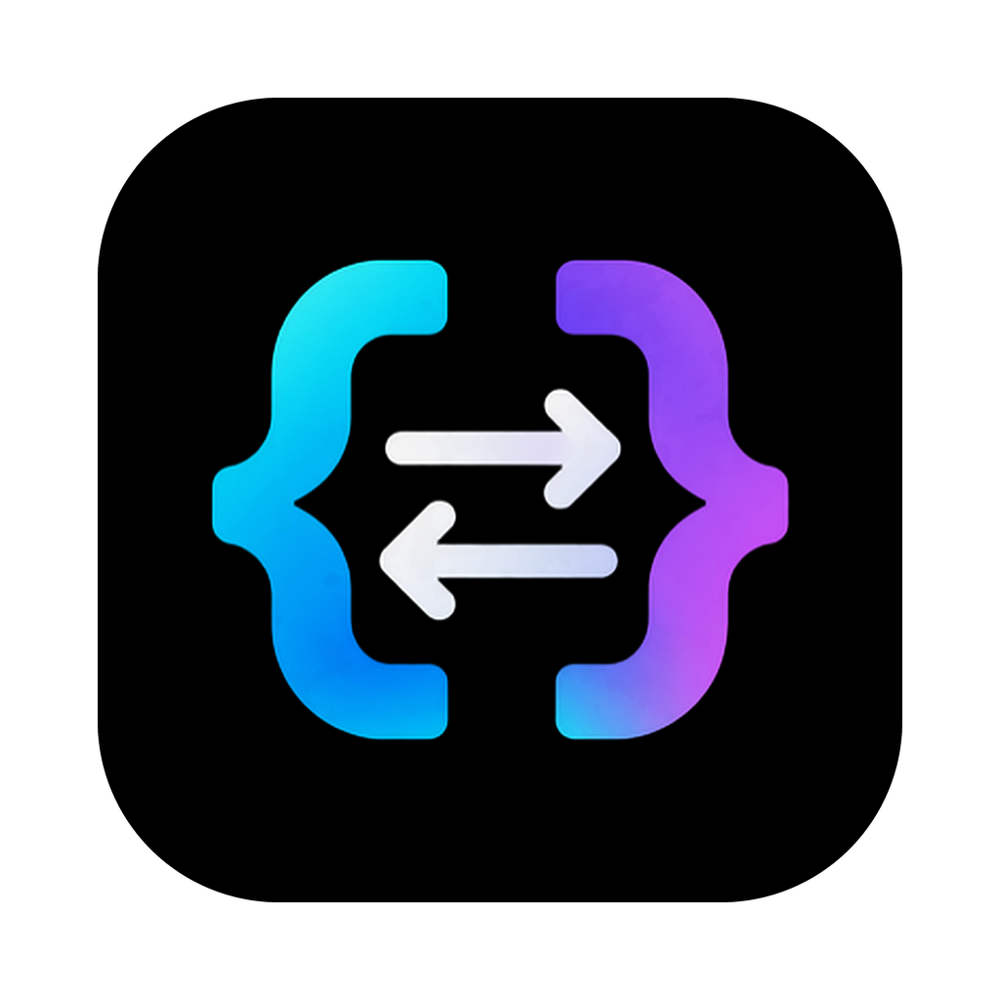
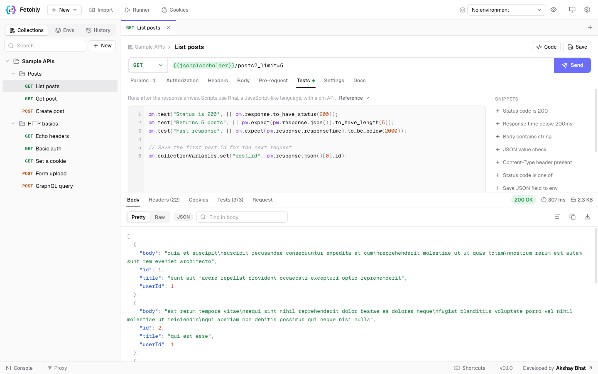
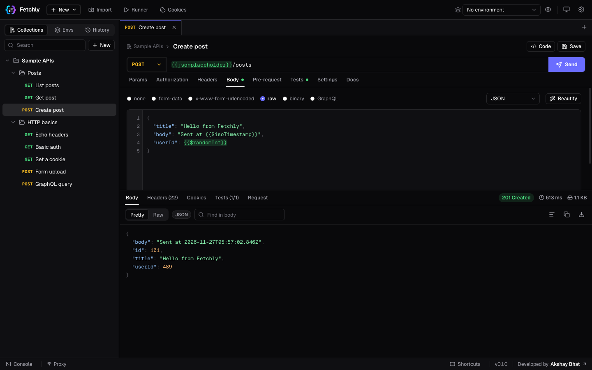
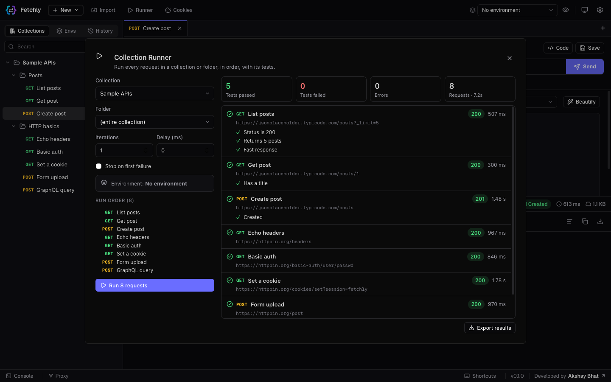
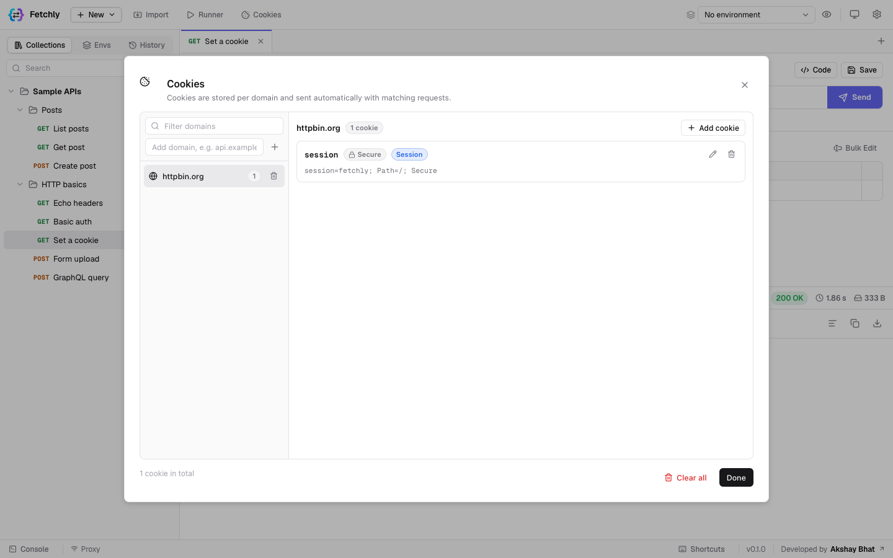
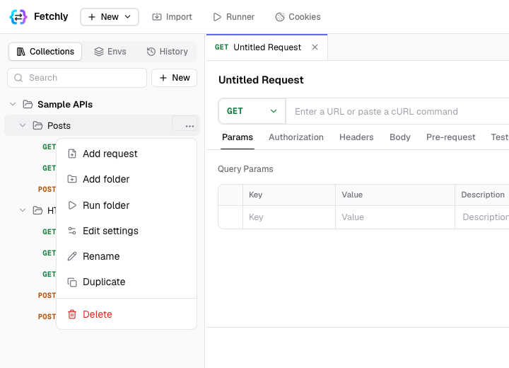

<p align="center">
  
</p>

<h1 align="center">Fetchly</h1>

<p align="center">
  <b>A fast, private, open-source API client.</b><br>
  Native on macOS, Windows and Linux, and self-hostable on the web. Built in Rust.
</p>

<p align="center">
  Developed by <a href="https://akshaybhat.online">Akshay Bhat</a>
</p>



---

## Contents

- [Why Fetchly](#why-fetchly)
- [Fetchly vs Postman](#fetchly-vs-postman)
- [Features](#features)
- [Screenshots](#screenshots)
- [Install](#install)
- [Build from source](#build-from-source)
  - [Prerequisites](#prerequisites)
  - [macOS](#macos)
  - [Windows](#windows)
  - [Linux](#linux)
  - [Web](#web)
- [Moving from Postman](#moving-from-postman)
- [Scripting and tests](#scripting-and-tests)
- [Keyboard shortcuts](#keyboard-shortcuts)
- [Where your data lives](#where-your-data-lives)
- [Project structure](#project-structure)
- [Development](#development)
- [Credits and license](#credits-and-license)

---

## Why Fetchly

Fetchly does the everyday work of an API client — build a request, send it, inspect the response, test it, organise it into collections — and stays out of your way while doing it.

- **No account, no cloud, no telemetry.** Open the app and start sending requests. Your collections, environments, tokens and cookies stay on your machine in a single JSON file you can read, back up or put in git.
- **Small and fast.** Fetchly is a native Rust application. The macOS installer is about **15 MB** (universal: Apple Silicon and Intel) and the Windows installer about **5 MB**. There is no bundled Chromium.
- **Works offline.** Everything except the requests you choose to send runs locally.
- **Open source.** Read the code, change it, build it yourself.
- **Brings your Postman work with you.** Import Postman collections (v2.0 / v2.1) and environments, and export back to the same format at any time. You are never locked in.
- **One codebase, every platform.** The same app runs natively on macOS, Windows and Linux, and in the browser through a small server you host yourself.
- **No usage limits.** Run collections as often as you like, with as many iterations as you like.

## Fetchly vs Postman

Postman is the most widely used API platform, and it does far more than Fetchly. Fetchly focuses on being an excellent, private, local API client.

### At a glance

| | **Fetchly** | **Postman** |
|---|---|---|
| Account required | **No** | Sign-in needed for most features |
| Where your data is stored | **Your machine** (one local JSON file) | Synced to Postman's cloud |
| Works fully offline | **Yes** | Limited |
| Source code | **Open source** | Proprietary |
| Desktop technology | **Native Rust + system webview** | Electron (bundles Chromium) |
| Installer size | **~15 MB macOS, ~5 MB Windows** | Much larger |
| Collection runner limits | **None** | Depends on plan |
| Self-hosted web version | **Yes** (`fetchly-server`, Docker) | Hosted by Postman |
| Postman collection import / export | **Yes** (v2.0 / v2.1, both directions) | Native format |
| HTTP methods, params, headers, auth, bodies | Yes | Yes |
| Environments, globals, collection variables | Yes | Yes |
| Pre-request and test scripts | Yes (Rhai, `pm`-style API) | Yes (JavaScript) |
| Collection runner | Yes | Yes |
| Code generation | Yes (9 languages) | Yes (more languages) |
| Cookie manager | Yes | Yes |
| Team workspaces, sharing, comments | No | Yes |
| Mock servers, monitors, scheduled runs | No | Yes |
| API design (OpenAPI), published docs | No | Yes |
| WebSocket, gRPC, MQTT, Socket.IO | No | Yes |
| OAuth 2.0 token flows (get a new token in-app) | No — paste a token | Yes |
| Digest, AWS Signature, NTLM, Hawk auth | No | Yes |
| Command-line runner for CI | No | Yes (Newman / Postman CLI) |

### Choose Fetchly when…

- you want an API client that **opens instantly, without signing in**;
- your requests carry **secrets or internal URLs** you don't want stored in someone else's cloud;
- you work **offline**, behind a corporate firewall, or on a machine where you can't install large apps;
- you want to **self-host** an API client for your team's browser;
- you like owning your tools: **open source**, plain-file storage, no plan limits.

### Choose Postman when…

- your team **collaborates** in shared workspaces and needs comments, roles and history;
- you need **mock servers, monitors**, OpenAPI design or published documentation;
- you test **WebSocket, gRPC or MQTT** APIs;
- you rely on **JavaScript test scripts** or run collections in CI with Newman.

You don't have to pick one forever. Fetchly reads and writes Postman's collection and environment files, so you can move work in either direction.

> Postman is a trademark of Postman, Inc. Fetchly is an independent project and is not affiliated with or endorsed by Postman.

## Features

### Requests
- Methods: **GET, POST, PUT, PATCH, DELETE, HEAD, OPTIONS**.
- **Multiple tabs**, each with its own request and response. Unsaved changes are marked; closing a modified tab asks to save.
- **URL ⇄ params sync**: edit the query string or the Params table and the other updates.
- **Paste a cURL command** straight into the URL bar to turn it into a full request.
- **Bulk edit** any key/value table (params, headers, form fields, variables) as plain `key:value` text.
- Per-request settings: follow redirects, verify SSL certificates, timeout.
- A **Docs** tab for a description of each request.

### Request bodies
- **none**, **raw** (JSON, Text, XML, HTML, JavaScript) with syntax highlighting, line numbers, JSON validation and *Beautify*.
- **form-data** with text and file fields (and optional per-field content type).
- **x-www-form-urlencoded**.
- **binary** (send a file as the body).
- **GraphQL** query + variables.

### Authorization
- Inherit from parent, No Auth, **Basic**, **Bearer token**, **API key** (header or query param), **OAuth 2.0** access token.
- Set auth once on a **collection or folder**; requests set to *Inherit* use it automatically.

### Variables and environments
- `{{variable}}` works in the URL, params, headers, auth and bodies.
- Variables are **highlighted green when defined and red when not**, and the URL bar warns about undefined variables before you send.
- Scopes and precedence: **local → environment → collection → global**.
- **Dynamic variables**: `{{$guid}}`, `{{$randomUUID}}`, `{{$timestamp}}`, `{{$timestampMs}}`, `{{$isoTimestamp}}`, `{{$randomInt}}`, `{{$randomBoolean}}`, `{{$randomFirstName}}`, `{{$randomLastName}}`, `{{$randomFullName}}`, `{{$randomEmail}}`, `{{$randomWord}}`, `{{$randomColor}}`, `{{$randomIP}}`.
- Create, rename, duplicate, delete, **import and export** environments; switch the active environment from the header.

### Collections
- Nested **folders**, unlimited depth.
- **Drag and drop** to reorder requests and folders, move them into folders, move them between collections, and reorder collections. A drop indicator shows exactly where an item will land.
- Right-click (or the `…` button) for actions: add request, add folder, run, edit settings, rename, duplicate, export, delete. Double-click to rename inline.
- Collection and folder settings: description, authorization, pre-request script, test script, and collection variables.
- Search across collection, folder and request names and URLs.

### Scripts and tests
- **Pre-request** and **test** scripts at collection, folder and request level (run outermost first).
- A familiar `pm` API: `pm.test`, `pm.expect(...)`, `pm.environment`, `pm.globals`, `pm.collectionVariables`, `pm.variables`, `pm.request`, `pm.response`, `pm.execution.setNextRequest`, `console.log`.
- One-click **snippets** for common checks, and a built-in scripting reference.
- Scripts are **sandboxed** and stopped automatically if they loop forever.

### Responses
- **Status**, **time** and **size** at a glance.
- **Pretty** view with syntax highlighting for JSON, XML and HTML, and a **Raw** view.
- **Find in body** with highlighted matches, line wrapping, copy, and **save to file** (including binary responses).
- Response **headers**, **cookies**, **test results** (filter all / passed / failed), and the **exact request that was sent** (resolved URL, headers and body).

### Cookies
- One shared **cookie jar** used by every request, following domain, path, expiry and Secure rules. Cookies set during redirects are kept too.
- **Cookie manager**: browse cookies by domain; add, edit (name, value, domain, path, expiry, Secure, HttpOnly) and delete cookies; clear a domain or everything.
- Cookies are saved and restored with the rest of your workspace.

### Collection runner
- Run a whole **collection or a single folder** in order.
- **Iterations**, **delay** between requests, **stop on first failure**.
- Flow control from scripts with `pm.execution.setNextRequest("name")` or stop with `setNextRequest(())`.
- Live results with pass/fail per test, timing and status for each request, totals, and **export results as JSON**.

### Code generation
Generate ready-to-run snippets for the current request, with variables resolved: **cURL, Python (requests), JavaScript (fetch), Node.js (axios), Rust (reqwest), Go (net/http), raw HTTP, HTTPie, PowerShell**.

### Import and export
- Import **Postman Collection v2.0 / v2.1**, **Postman environments**, **cURL commands**, and Fetchly workspace backups — from a file or by pasting.
- Export collections (Postman v2.1 format), environments, and a **full workspace backup**.

### Everything else
- **History** of every request you send, grouped by day; reopen any of them in a tab.
- **Console** with each request's headers, body and response headers, plus script logs and errors.
- **Light, dark and system** themes; adjustable interface scale; resizable sidebar and editor/response split.
- **Autosave** — there is nothing to remember to save except the requests you want in a collection.
- A **sample collection** on first launch so you can try everything immediately.

## Screenshots

| | |
|---|---|
|  |  |
| Dark theme with a JSON body and a 201 response | Collection runner with live test results |
|  |  |
| Cookie manager | Sidebar actions menu |

## Install

**[⬇ Download the latest release](https://github.com/lycanbhat/Fetchly/releases/latest)** — ready-made builds for every platform:

| Platform | File | Notes |
|---|---|---|
| macOS 11+ (Apple Silicon & Intel) | `Fetchly-<version>-macos-universal.dmg` | Open it and drag **Fetchly** to **Applications**. |
| Windows 10 / 11 (x64) | `Fetchly-<version>-windows-x64-setup.exe` | Installs for the current user, no admin rights needed. Adds Start menu and desktop shortcuts and an uninstaller. |
| Windows, no install | `Fetchly-<version>-windows-x64-portable.zip` | Unzip and run `Fetchly.exe`. Keep `WebView2Loader.dll` next to it. |
| Linux — Debian / Ubuntu (x64) | `fetchly_<version>_amd64.deb` | `sudo apt install ./fetchly_<version>_amd64.deb` |
| Linux — other distributions (x64) | `Fetchly-<version>-linux-x86_64.tar.gz` | Extract and run `./install.sh` (installs to `~/.local`, no root). Needs the WebKitGTK 4.1 runtime. |

**First launch warnings.** The builds are not code-signed, so the OS asks for confirmation the first time:

- **macOS** — right-click Fetchly in Applications → **Open** → **Open**. (Or run `xattr -cr /Applications/Fetchly.app` once.)
- **Windows** — on the *Windows protected your PC* screen, click **More info** → **Run anyway**.

Signing the apps (an Apple Developer ID and a Windows code-signing certificate) removes these warnings.

## Build from source

### Prerequisites

All platforms need **Rust (stable)**:

```sh
curl --proto '=https' --tlsv1.2 -sSf https://sh.rustup.rs | sh     # macOS / Linux
# Windows: download and run rustup-init.exe from https://rustup.rs
```

Then clone the repository and work from its root folder.

Quick start, on any platform:

```sh
cargo run --release        # builds and launches the desktop app
```

### macOS

**Requirements:** macOS 11 or later, Xcode Command Line Tools (`xcode-select --install`).

```sh
# Run it
cargo run --release

# Build an installable .app + .dmg for this Mac's chip
./scripts/bundle-macos.sh

# Build a universal .app + .dmg (Apple Silicon and Intel) — use this to share with others
./scripts/bundle-macos.sh universal
```

Output:

- `target/macos/Fetchly.app`
- `target/macos/Fetchly-<version>.dmg`

The universal build adds the `x86_64-apple-darwin` and `aarch64-apple-darwin` Rust targets automatically. The app is ad-hoc signed so it runs on your own Mac; to distribute without Gatekeeper warnings, sign and notarize it with an Apple Developer ID.

### Windows

Fetchly's interface runs on **Microsoft Edge WebView2**, which is built into Windows 11 and present on most up-to-date Windows 10 PCs. The installer checks for it and offers the download page if it's missing.

#### Option A — cross-build from macOS (used for the release installers)

```sh
# one-time setup
brew install mingw-w64 makensis
rustup target add x86_64-pc-windows-gnu

# build the installer and the portable zip
./scripts/build-windows.sh
```

Output:

- `target/windows/Fetchly-Setup-<version>.exe` — installer
- `target/windows/Fetchly-<version>-portable.zip` — `Fetchly.exe` + `WebView2Loader.dll`

The same script works on Linux with `mingw-w64` and `nsis` installed from your package manager.

#### Option B — build on Windows

1. Install [Visual Studio Build Tools](https://visualstudio.microsoft.com/visual-cpp-build-tools/) with the **Desktop development with C++** workload.
2. Install Rust with `rustup-init.exe` (the default MSVC toolchain).
3. In a terminal, from the repository root:

   ```powershell
   cargo build --release -p fetchly
   ```

4. The app is `target\release\fetchly.exe`. If the build output contains a `WebView2Loader.dll`, keep it next to the `.exe` when you copy the app elsewhere.

### Linux

**Requirements:** the WebKitGTK and GTK development packages.

```sh
# Debian / Ubuntu (22.04+)
sudo apt install build-essential pkg-config libwebkit2gtk-4.1-dev libgtk-3-dev \
                 libxdo-dev libayatana-appindicator3-dev librsvg2-dev

# Fedora
sudo dnf install gcc pkgconf-pkg-config webkit2gtk4.1-devel gtk3-devel libxdo-devel \
                 libappindicator-gtk3-devel librsvg2-devel

# Arch
sudo pacman -S --needed base-devel webkit2gtk-4.1 gtk3 xdotool libappindicator-gtk3 librsvg
```

Build and run:

```sh
cargo build --release -p fetchly
./target/release/fetchly
```

To add Fetchly to your application menu:

```sh
install -Dm755 target/release/fetchly ~/.local/bin/fetchly
install -Dm644 assets/brand/fetchly-app.png ~/.local/share/fetchly/fetchly.png
mkdir -p ~/.local/share/applications
cat > ~/.local/share/applications/fetchly.desktop <<EOF
[Desktop Entry]
Name=Fetchly
Comment=API client
Exec=$HOME/.local/bin/fetchly
Icon=$HOME/.local/share/fetchly/fetchly.png
Type=Application
Categories=Development;
EOF
```

People who run the binary on another machine need the WebKitGTK **runtime** libraries (`libwebkit2gtk-4.1-0` on Debian/Ubuntu), which most desktop distributions already include.

> The Linux build follows the Dioxus desktop requirements but hasn't been tested on a Linux machine yet. If you hit a problem, please open an issue.

### Web

The web version is the same app compiled to WebAssembly. Browsers block most cross-origin API calls (CORS) and some headers, so the web app sends requests through **`fetchly-server`**, a small relay you run yourself. With the relay, the web app behaves like the desktop app — including redirects and cookies.

**One-time setup:**

```sh
rustup target add wasm32-unknown-unknown
rustup component add llvm-tools
cargo install dioxus-cli@0.7.10 --locked
```

**Build and run** (from the repository root):

```sh
dx build --platform web --release -p fetchly
cargo run --release -p fetchly-server -- --dist target/dx/fetchly/release/web/public
```

Open <http://127.0.0.1:8080>. The server serves the app and the relay together, and the app finds the relay automatically.

**`fetchly-server` options**

| Option | Default | Meaning |
|---|---|---|
| `--host` | `127.0.0.1` | Interface to listen on. Use `0.0.0.0` to accept connections from other machines. |
| `--port` | `8080` (or `$PORT`) | Port to listen on. |
| `--dist` | `./dist` | Folder containing the built web app. |
| `FETCHLY_PROXY_TOKEN` (env) | unset | If set, relay requests must send this token. Enter it in **Settings → Network → Proxy token**. |

> **Security:** the relay makes HTTP requests on behalf of anyone who can reach it. Keep it on `127.0.0.1`, or set `FETCHLY_PROXY_TOKEN` (and ideally put it behind your own authentication) before exposing it on a network.

**Deploy with Docker**

```sh
docker build -t fetchly .
docker run -p 8080:8080 -e FETCHLY_PROXY_TOKEN=change-me fetchly
```

**Static hosting without the relay.** You can upload `target/dx/fetchly/release/web/public` to any static host. In that case turn off **Settings → Network → Use Fetchly proxy**; the app can then only call APIs that allow cross-origin requests, and the browser manages cookies itself.

**Live development:** `dx serve --platform web -p fetchly` rebuilds on every change. Run `fetchly-server` alongside it and point **Settings → Network → Proxy endpoint** at it (for example `http://127.0.0.1:8080/api/proxy`).

## Moving from Postman

1. In Postman, export a collection (**… → Export → Collection v2.1**) and your environments (**Environments → … → Export**).
2. In Fetchly, click **Import** and choose the files, or paste their contents.
3. Collections, folders, requests, headers, bodies, auth, variables and descriptions come across. Postman's JavaScript scripts are kept **as comments** in the script editors, so nothing breaks and you can port them when you need them — most `pm.test` / `pm.expect` checks translate almost line for line (see below).

To go back, export any collection from Fetchly's sidebar menu; it's saved in Postman v2.1 format.

## Scripting and tests

Scripts are written in [Rhai](https://rhai.rs), a small, safe, JavaScript-like language that runs the same on desktop and web. The main difference from JavaScript: closures are written `|| expr` or `|| { … }` instead of `function () { … }`, and assertion methods use `snake_case`.

```js
// Tests tab
pm.test("Status is 200", || pm.response.to_have_status(200));

pm.test("Returns three items", || {
    let data = pm.response.json();
    pm.expect(data.items).to_have_length(3);
    pm.expect(data.total).to_be_above(0);
    pm.expect(data.name).not.to_equal("");
});

// Save a value for later requests
pm.environment.set("token", pm.response.json().access_token);
```

```js
// Pre-request tab
pm.request.headers.upsert("X-Request-Id", uuid());
pm.variables.set("now", timestamp());
```

| Postman (JavaScript) | Fetchly (Rhai) |
|---|---|
| `pm.test("ok", function () { … })` | `pm.test("ok", \|\| { … })` |
| `pm.response.to.have.status(200)` | `pm.response.to_have_status(200)` |
| `pm.expect(x).to.eql(y)` | `pm.expect(x).to_eql(y)` |
| `pm.expect(x).to.be.above(5)` | `pm.expect(x).to_be_above(5)` |
| `pm.expect(x).to.include("a")` | `pm.expect(x).to_include("a")` |
| `pm.expect(x).to.not.equal(y)` | `pm.expect(x).not.to_equal(y)` |
| `JSON.parse(text)` / `JSON.stringify(v)` | `parse_json(text)` / `to_json(v)` |

Assertions: `to_equal`, `to_eql`, `to_be_above`, `to_be_below`, `to_include`, `to_have_property`, `to_be_true`, `to_be_false`, `to_exist`, `to_be_a("string" | "number" | …)`, `to_have_length`, `to_match("wild*card")`, plus `.not` to negate. Utilities: `console.log`, `print`, `uuid()`, `timestamp()`, `base64_encode`, `base64_decode`.

Click **Reference** above any script editor for the complete API.

## Keyboard shortcuts

| Shortcut | Action |
|---|---|
| ⌘ / Ctrl + Enter | Send request |
| ⌘ / Ctrl + S | Save request |
| ⌘ / Ctrl + T | New tab |
| ⌘ / Ctrl + O | Import |
| Enter in the URL bar | Send request |
| Middle-click a tab | Close it |
| Double-click a sidebar item | Rename |
| Right-click a sidebar item | Actions menu |

## Where your data lives

Fetchly saves automatically every couple of seconds:

| Platform | Location |
|---|---|
| macOS | `~/Library/Application Support/Fetchly/state.json` |
| Windows | `%APPDATA%\Fetchly\data\state.json` |
| Linux | `~/.local/share/fetchly/state.json` |
| Web | The browser's local storage for the site |

The file contains your collections, environments, globals, cookies, history, open tabs and settings. To move everything to another machine (or between desktop and web), use **Settings → Export backup** and import the file on the other side.

## Project structure

```
crates/
  core/      fetchly-core — the engine, shared by every platform
             models, variables, HTTP, cookie jar, scripting (Rhai),
             cURL import, code generation, Postman import/export
  app/       fetchly — the user interface (Dioxus 0.7)
    src/ui/          sidebar, editor, response, dialogs, header/footer
    src/components/  Dioxus components (dialog, menus, switch, …)
    styles/          theme and app stylesheet
    assets/          fonts, brand icons
  server/    fetchly-server — serves the web build and relays requests
assets/      app icons (macOS .icns, Windows .ico), Windows installer script
scripts/     bundle-macos.sh, build-windows.sh
docs/        screenshots
```

All CSS, fonts and icons are compiled into the executable, so the desktop app is a single self-contained file (plus `WebView2Loader.dll` on Windows).

## Development

```sh
cargo test --workspace                       # engine and UI helper tests
cargo run -p fetchly                         # desktop app, debug build
dx serve --platform web -p fetchly           # web app with live rebuilds

# check the web build compiles without running dx
cargo check -p fetchly --target wasm32-unknown-unknown --no-default-features --features web
```

`.github/workflows/build.yml` runs the tests and builds every platform on each push. `.github/workflows/release.yml` publishes a GitHub Release with macOS, Windows and Linux packages whenever a version tag is pushed:

```sh
git tag v0.1.1 && git push origin v0.1.1
```

## Credits and license

Fetchly is developed by **[Akshay Bhat](https://akshaybhat.online)**.

It's built with:

- [Dioxus](https://dioxuslabs.com) and the [Dioxus components](https://github.com/DioxusLabs/components) library (MIT / Apache-2.0)
- [Lucide](https://lucide.dev) icons via `lucide-dioxus` (ISC)
- [Geist and Geist Mono](https://vercel.com/font) fonts (SIL Open Font License 1.1)
- [reqwest](https://github.com/seanmonstar/reqwest), [Rhai](https://rhai.rs), [axum](https://github.com/tokio-rs/axum)

Fetchly is released under the [MIT License](LICENSE). Bundled third-party components keep their own licenses, listed above.
